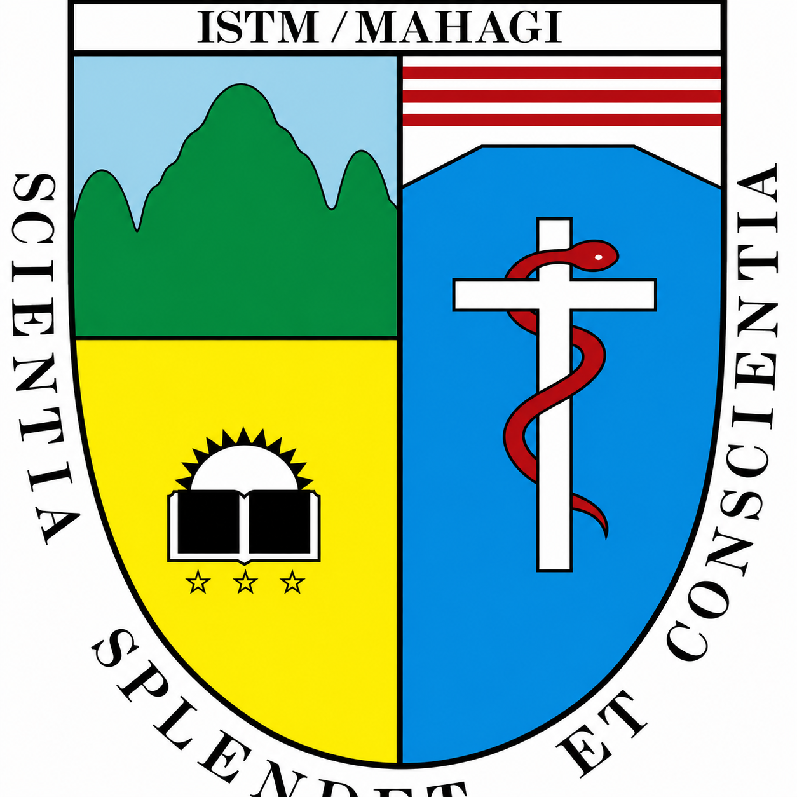

# Walkthrough - Refonte Dark-Premium "A Propos" & Console CMS

J'ai accéléré le développement pour livrer une expérience institutionnelle **Ultra-Premium** et totalement administrable. Toutes les pages d'information sont désormais passées en mode **Dark-Luxe** et sont connectées à une nouvelle console de gestion.

## Nouvelles Fonctionnalités d'Administration

### 1. Console de Gestion Institutionnelle (CMS)
- **Accès Unique** : Ajout d'un bouton "Gestion Institutionnelle" dans le menu Admin qui centralise toute la configuration des pages "A Propos".
- **Modules Opérationnels** :
  - **Historique** : Éditeur complet pour modifier le récit fondateur.
  - **Mission & Vision** : Interface dédiée pour ajuster les valeurs de l'institution.
  - **Comité de Gestion** : Système complet d'ajout, modification et suppression des membres de la direction.

## Refonte Visuelle "Dark-Luxe"

### 1. Pages Publiques Sublimées
Toutes les sections suivantes ont été converties vers le thème **Deep Navy & Academic Gold** pour éliminer le blanc éblouissant :
- **Notre Histoire** : Présentation narrative sur fond sombre texturé.
- **Mission & Vision** : Cartes à accentuation néon bleu et or.
- **Comité de Gestion** : Grille de profils avec avatars en halo doré et typographie de prestige.
- **Hymne ISTM** : Lecteur audio premium intégré dans un environnement nocturne élégant.

### 2. Esthétique et Confort
- **Zéro Éblouissement** : Utilisation exclusive du bleu marine profond (`#0A192F`) et du bleu surface (`#112240`).
- **Prestige** : Titres en **Or Académique** et typographie **Playfair Display**.
- **Fluidité** : Entry animations systématiques avec `PremiumFadeIn`.

## Technique
- **Real-time** : Toutes les pages écoutent désormais les modifications en temps réel via Firestore. Si l'admin change un texte, il change instantanément pour tout le monde.
- **Responsive** : Design adapté automatiquement aux écrans d'ordinateurs (Windows) et aux mobiles.

> [!TIP]
> Vous pouvez maintenant mettre à jour tout le contenu "A Propos" sans toucher à une seule ligne de code, directement depuis votre tableau de bord administrateur.

 *Note: Aperçu visuel de la nouvelle gestion.*
